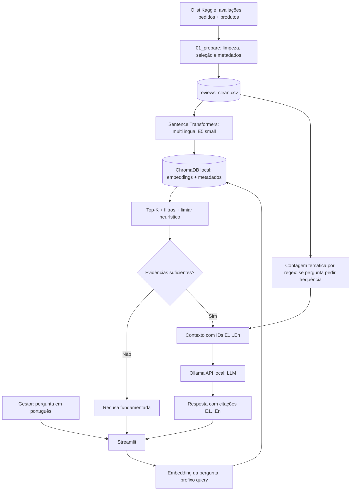

# Voice of Customer Intelligence com RAG — FIAP Tech Challenge, Fase 4

[](https://www.python.org/)
[](https://streamlit.io/)
[](https://www.trychroma.com/)

Aplicação de **Inteligência Artificial Generativa com RAG** para responder perguntas em português sobre comentários reais de clientes do **Brazilian E-Commerce Public Dataset by Olist (2016–2018)**. O sistema recupera avaliações relevantes e fornece os identificadores das fontes para rastreabilidade.

**Escopo do desafio:** construção de conhecimento, preparação do texto, embeddings, indexação, recuperação, contexto e geração com LLM; evidências; recusa diante de ausência de suporte; repositório público e vídeo demonstrativo de até 7 minutos.

VÍDEO DE APRESENTAÇÃO

[INSERIR LINK DO VÍDEO APÓS A GRAVAÇÃO]

## 1. Requisitos

- Windows 10/11 com PowerShell, Python **3.12 (64 bits)** e Git. Python 3.11 também é aceitável; 3.12 é a versão de referência deste projeto.
- Acesso à internet para baixar os CSVs e, na primeira execução, os modelos.
- **Ollama** para as respostas geradas localmente (não exige API key). Recomenda-se RAM suficiente para o modelo. Um computador menos potente pode usar `llama3.2:1b` no `.env`.
- `Kaggle` é opcional se baixar os dados manualmente.

Links: [Olist no Kaggle](https://www.kaggle.com/datasets/olistbr/brazilian-ecommerce/data) · [Python](https://www.python.org/downloads/) · [Git](https://git-scm.com/downloads/win) · [Ollama](https://ollama.com/download/windows) · [GitHub CLI](https://cli.github.com/).

## 2. Guia rápido — PowerShell (Windows)

Abra o PowerShell na pasta em que deseja manter o projeto. **Extraia o ZIP deste projeto** para uma pasta chamada `fiap-tech-challenge-fase4`. Não copie todo o código manualmente.

```powershell
cd "C:\Projetos\fiap-tech-challenge-fase4"
py -3.12 -m venv .venv
# Apenas se o PowerShell bloquear scripts nesta sessão:
Set-ExecutionPolicy -Scope Process -ExecutionPolicy Bypass
.\.venv\Scripts\Activate.ps1
python -m pip install --upgrade pip
python -m pip install -r requirements.txt
Copy-Item .env.example .env
```

Se `py -3.12` não funcionar, instale Python 3.12 e reabra o terminal. Confira `py -0p`. Com Python 3.11 use `py -3.11 -m venv .venv`.

### Baixe os dados Olist — opção A, pelo site (mais simples)

1. Acesse https://www.kaggle.com/datasets/olistbr/brazilian-ecommerce/data e autentique-se se necessário.
2. Clique em **Download** para obter o ZIP do conjunto completo.
3. Extraia os CSVs diretamente em `data/raw/` (não deixe os arquivos aninhados numa subpasta).
4. Confira se `data/raw/olist_order_reviews_dataset.csv` existe.

A base disponibiliza nove CSVs; este projeto exige o CSV das avaliações. Os arquivos de pedidos, itens e produtos enriquecem o índice com metadados.

### Baixe os dados Olist — opção B, Kaggle CLI

```powershell
# O ambiente virtual ainda precisa estar ativo
kaggle datasets download -d olistbr/brazilian-ecommerce -p data/raw --unzip
python scripts/00_check_data.py
```

Se houver erro de autenticação: configure as credenciais de acordo com as instruções da conta Kaggle (Settings → API). Em versões que utilizam arquivo `kaggle.json`, coloque-o em `$HOME\.kaggle\kaggle.json`; **nunca** no repositório. Alternativamente, baixe o ZIP manualmente.

### Prepare e indexe os comentários

```powershell
python scripts/00_check_data.py
python scripts/01_prepare.py
python scripts/03_eda.py
# Teste rápido: indexar 5 mil comentários primeiro
python scripts/02_index.py --rebuild --limit 5000
python scripts/04_smoke_test.py
```

**Atenção:** para a versão final representativa, reindexe **todos** os comentários com:

```powershell
python scripts/02_index.py --rebuild
```

A geração de embeddings pode consumir tempo e baixar o modelo `intfloat/multilingual-e5-small` na primeira execução. Se reindexar, substitui-se o conjunto de 5 mil pelo corpus completo. Mantenha o terminal aberto até terminar. Os índices ficam em `data/vectorstore/` e não são enviados ao Git.

### Instale e execute o LLM local

Instale [Ollama para Windows](https://ollama.com/download/windows) e abra o aplicativo (servidor local). Em um terminal PowerShell:

```powershell
ollama pull llama3.2:3b
ollama list
```

Se o modelo for pesado, use `ollama pull llama3.2:1b` e altere `OLLAMA_MODEL=llama3.2:1b` no arquivo `.env`.

### Inicie a aplicação

```powershell
# Na pasta raiz do projeto, com .venv ativado:
python -m streamlit run app.py
```

Abra a URL local exibida no terminal (normalmente `http://localhost:8501`). Para testar sem Ollama, **desmarque** `Gerar resposta com Ollama` na barra lateral: a aplicação ainda exibirá avaliações relevantes, mas não sintetizará uma resposta por LLM.

### Teste a qualidade

```powershell
python -m pytest -q
python scripts/05_evaluate.py
```

O arquivo `artifacts/evaluation_manual.csv` inclui perguntas e IDs de evidências recuperadas. Preencha manualmente as colunas de relevância/fundamentação para auditar os resultados. Medidas como `Recall@k` exigem um conjunto de IDs relevantes rotulados; **não reivindicamos um Recall@k automaticamente sem ground truth**.

## 3. Arquitetura



### Pipeline e justificativas

1. **Seleção/limpeza:** agrega título e corpo textual, normaliza espaços, remove textos ausentes/curtos (menos de 12 caracteres), notas inválidas e duplicatas. Não gera documentos fictícios. Os comentários curtos são uma limitação documentada.
2. **Metadados:** nota 1–5, mês/ano, categoria representativa de produtos e atraso na entrega quando disponíveis. Comentários multi-item têm uma única categoria representativa determinística (não classificação perfeita da cesta). Pedidos com data de entrega ausente não são tratados como atrasados.
3. **Documentos:** uma avaliação válida por ID estável calculado por hash do `review_id`, `order_id` e texto. O documento guarda a avaliação completa; textos muito longos são truncados a 1.500 caracteres **na entrada do embedding**, mas a fonte textual é preservada para citação.
4. **Embedding:** modelo multilíngue `intfloat/multilingual-e5-small`, com prefixo `passage:` para comentários e `query:` para perguntas; vetores normalizados.
5. **Indexação:** ChromaDB local, distância cosseno, metadados e IDs recuperáveis. Índice reconstruível com `--rebuild`.
6. **Recuperação:** busca semântica top-k, possibilidade de filtro por nota, categoria, ano e atraso, além de limiar configurável de similaridade. **Similaridade cosseno não equivale a probabilidade de verdade**; o limiar é heurístico e precisa ser calibrado.
7. **Geração:** Ollama com prompt que restringe a resposta às evidências e exige citações; temperatura 0 para reduzir variabilidade. Comentários são tratados como dados não confiáveis, não instruções.
8. **Perguntas sobre frequência:** adicionalmente, conta menções a temas na base filtrada usando regex. São *proxies* e podem sobrepor-se; por isso não confundimos os top-k recuperados com a incidência de uma categoria na base completa.
9. **Insuficiência de evidências:** recusa se não houver resultados acima do limiar ou para perguntas explicitamente fora do escopo; o prompt também instrui o LLM a recusar alegações sem suporte.

## 4. Organização dos arquivos

```text
fiap-tech-challenge-fase4/
├── app.py                      # interface Streamlit
├── src/voc/
│   ├── config.py               # caminhos, modelos e variáveis
│   ├── prepare.py              # limpeza e junções
│   ├── retriever.py            # embeddings e ChromaDB
│   ├── analysis.py             # análise quantitativa descritiva
│   └── rag.py                  # prompt, recuperação e chamada ao LLM
├── scripts/
│   ├── 00_check_data.py
│   ├── 01_prepare.py
│   ├── 02_index.py
│   ├── 03_eda.py
│   ├── 04_smoke_test.py
│   └── 05_evaluate.py
├── tests/                      # testes unitários
├── docs/                       # roteiro, exemplos e decisões
├── data/raw/                   # CSVs originais (gitignored)
├── data/processed/             # CSV limpo (gitignored)
├── data/vectorstore/           # ChromaDB local (gitignored)
├── artifacts/                  # relatórios de EDA/avaliação (gitignored)
├── .env.example
├── .gitignore
└── requirements.txt
```

## 5. Perguntas para demonstração

- "Quais reclamações sobre entrega aparecem em avaliações de nota 1 e 2?"
- "O que os clientes elogiam na experiência de compra?"
- "Quais são os problemas mais frequentes nos comentários?" (contagens heurísticas de todo o conjunto filtrado)
- "Quais problemas de qualidade dos produtos são mencionados?"
- "Quais comentários sustentam a hipótese de atrasos na entrega?"
- "Qual é o preço do bitcoin hoje?" (fora do escopo, deve recusar)

**Observação:** o sistema mostra as respostas realmente geradas após execução local. Não apresentamos textos de demonstração como se fossem resultados já obtidos.

## 6. Critérios de validação e limites

- Conferir documentos recuperados, seus IDs, notas e texto de origem.
- Avaliar manualmente a relevância dos top-k e se cada afirmação citada corresponde ao comentário.
- Testar perguntas sem suporte, escopo externo, filtros restritivos e indisponibilidade do LLM.
- Risco remanescente: o LLM pode citar uma evidência que não fundamenta totalmente a conclusão. Por isso é essencial a auditoria manual e não se deve tratar a solução como uma ferramenta de decisão automática.
- Categorias de produtos por pedido: categoria representativa, pois pedidos multi-item podem incluir várias categorias; análises quantitativas por categoria exigiriam normalização por item.
- O modelo E5 é multilíngue; nomes de categoria estão no idioma original do conjunto e as consultas devem considerar esse fato.
- Dataset histórico e anonimizado (2016–2018); não representa o e-commerce atual. Alguns textos têm ausência de acentuação, ruído e referências anonimizadas.
- Dependendo dos recursos do computador, indexação e inferência local podem ser lentas. A configuração com 5 mil registros é um **MVP para demonstrar funcionamento**, não a avaliação final de todo o corpus.
- Os CSVs, índices e modelos não estão incluídos no repositório; o processo de reconstrução está documentado.

## 7. Publicar no GitHub (PowerShell)

Instale Git e, se quiser a criação do repositório pelo terminal, [GitHub CLI](https://cli.github.com/). Na pasta principal do projeto:

```powershell
git --version
git config --global user.name "SEU NOME"
git config --global user.email "SEU_EMAIL_DO_GITHUB"
git init
git branch -M main
git status
git add .
git status
git commit -m "Entrega Tech Challenge Fase 4 - RAG Olist"
```

**Método A — com GitHub CLI (recomendado):**

```powershell
gh auth login
gh repo create fiap-tech-challenge-fase4 --public --source=. --remote=origin --push
```

**Método B — pela interface web:** crie um repositório público vazio chamado `fiap-tech-challenge-fase4` em https://github.com/new (não marque "Add a README" para evitar divergência de histórico). Depois:

```powershell
git remote add origin https://github.com/SEU_USUARIO/fiap-tech-challenge-fase4.git
git push -u origin main
```

Verificações após subir:

```powershell
git status
git remote -v
git log -1 --oneline
git ls-files
```

No GitHub, confirme que há `README.md`, `app.py`, `scripts/`, `src/` e `tests/`, e que **não existem** `data/raw/*.csv`, `data/vectorstore/`, `.env`, `kaggle.json` nem `.venv/`. Se o Git pedir credenciais, use autenticação via navegador/Git Credential Manager ou GitHub CLI, não a senha comum da conta no terminal.

Se o repositório já existir, não rode `gh repo create` novamente: use `git add .; git commit -m "Atualização"; git push`.

## 8. Entregáveis FIAP e roteiro

1. **Repositório público GitHub:** todo o código e as instruções deste README.
2. **Vídeo de até 7 minutos:** seguir `docs/roteiro_video_7min.md`, mostrando arquitetura, preparação, recuperação, respostas com citações, limitações e recusa fora do escopo.

**Não basta enviar um ZIP de código:** execute a aplicação, confirme os CSVs, indexe o corpus, grave a demonstração e verifique que o GitHub contém o código. O ZIP é um pacote de partida, não prova de execução em sua máquina.

## 9. Fonte e créditos

- Olist. [Brazilian E-Commerce Public Dataset by Olist](https://www.kaggle.com/datasets/olistbr/brazilian-ecommerce/data). Dados anonimizados de pedidos de 2016–2018.
- [Kaggle CLI: download de datasets](https://github.com/Kaggle/kaggle-cli/blob/main/skills/references/datasets.md).
- [ChromaDB: consulta e filtro por metadados](https://docs.trychroma.com/).
- [Ollama: API local](https://docs.ollama.com/api/introduction).
- [GitHub CLI: gh repo create](https://cli.github.com/manual/gh_repo_create).

Conforme as condições do Kaggle, respeite a licença e as atribuições do dataset em qualquer uso subsequente. Este repositório não redistribui os CSVs.
